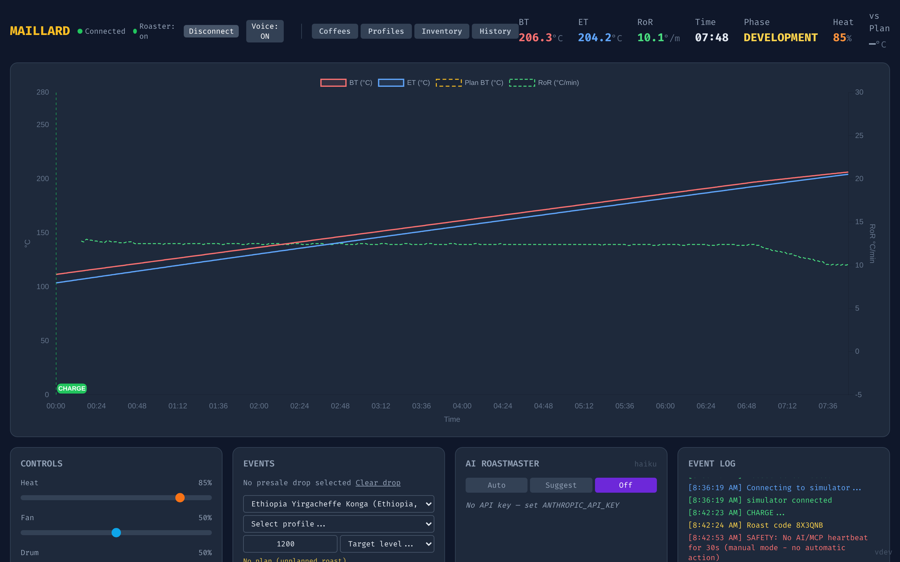
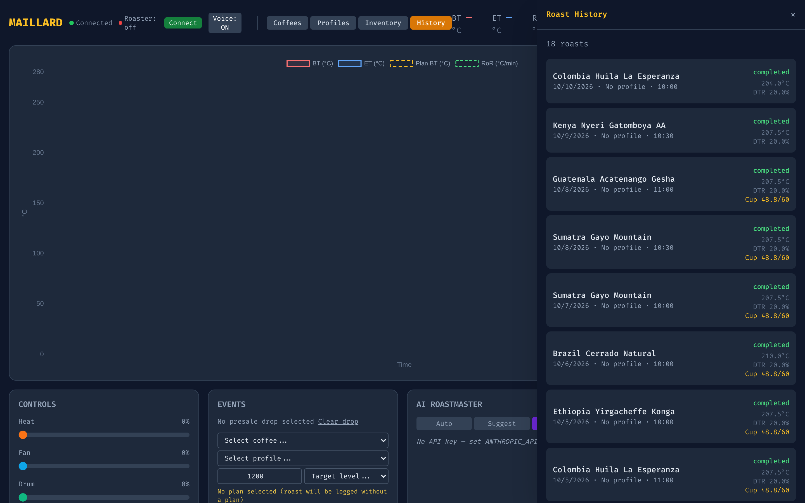
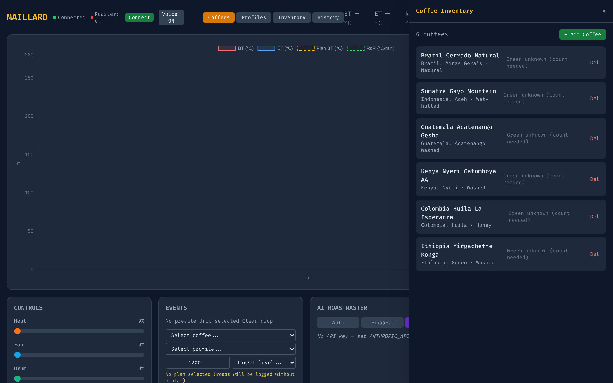

# Maillard

**An AI roast copilot for the Kaleido M10 coffee roaster.**

Maillard connects a real, fire-breathing drum roaster to an AI assistant. It talks to the Kaleido M10 over its network WebSocket, streams bean and environment temperatures in real time, plans roast profiles from the green coffee's origin, process, and density, coaches you live through drying, Maillard, and development, and records every roast so the next one is better.

- **Plans the roast.** AI-generated profiles and pre-roast recommendations (charge temp, initial heat and airflow) from coffee data and your own roast history.
- **Rides along live.** Real-time BT/ET, rate of rise, phase tracking, and a copilot that comments on the curve as it happens.
- **Keeps a human in charge.** Safety limits, watchdog, emergency stop, and explicit confirmations. Autonomous control is off by default.
- **Closes the loop.** Cupping scores, roast comparison, green-inventory ledger, and printable labels with QR codes.
- **Speaks MCP.** Works with Claude Desktop and any MCP client, plus a web UI and REST API.

## Screenshots

Real UI from a local demo run against the built-in roaster simulator, with synthetic coffees and roasts. No real roaster or AI key involved.

**Live roast dashboard.** Bean and environment temperature, rate of rise, phase, controls and the event log, streaming from the roaster.



| Roast history | Green coffee inventory |
|---|---|
|  |  |

## What is this?

Maillard is a **standalone** headless service that lets AI assistants (like Claude) control your coffee roaster. Talk to Claude about what you want to roast, and it handles the rest.

```
You: "I have an Ethiopian Yirgacheffe, washed process. Let's do a light roast for pour-over."

Claude: [Connects to roaster, generates profile, guides you through the roast]
```

Configure AI models independently in `.env` (restart Maillard after changes):

- `MAILLARD_AI_LIVE_MODEL=claude-haiku-4-5-20251001`: fast live roast advice (default).
- `MAILLARD_AI_PLAN_MODEL=claude-sonnet-4-5-20250929`: one-off profile and pre-roast planning (default).

`/api/ai/status` exposes both model names, including when AI is unavailable.
OAuth setup tokens (`sk-ant-oat01-`) supplied through `ANTHROPIC_API_KEY` use
Bearer authentication and the OAuth beta header. Credentials do not select models.
If AI profile generation fails, a warning is logged and the response reports `source="heuristic"`.
AUTO remains disabled by default (`MAILLARD_AI_AUTO_CONTROL_ENABLED=false`); roasting requires supervision.

## Quick Start (Docker)

The recommended way to run Maillard is via Docker, especially on a Synology NAS or any always-on machine.

For automated NAS deployment over Tailscale, see [NAS deployment](docs/deploy-nas.md).

**Prerequisites:** Docker and Docker Compose (included with Synology Container Manager).

```bash
# Clone and configure
git clone https://github.com/jtalborough/maillard.git
cd maillard
cp .env.example .env
# Edit .env — set MAILLARD_KALEIDO_HOST to your roaster's IP
#              set ANTHROPIC_API_KEY for the AI roast assistant (optional)

# Build and start
docker compose up -d

# Verify
curl http://localhost:8080/health
# → {"status": "healthy", "mongodb": "connected"}
```

Open `http://<your-machine-ip>:8080` in a browser to access the dashboard.

### Simulator mode (no roaster needed)

```bash
docker compose run --rm maillard web --host 0.0.0.0 --driver-type simulator
```

### Useful commands

```bash
docker compose logs -f maillard    # Follow app logs
docker compose restart maillard    # Restart after .env changes
docker compose down                # Stop everything (data persists)
docker compose down -v             # Stop and delete MongoDB data
```

### Data backup

MongoDB data is stored in the `mongo-data` Docker volume. Back it up with:

```bash
docker compose exec mongo mongodump --archive --gzip > maillard-backup.gz
```

## Quick Start (Development)

```bash
# Install
git clone https://github.com/jtalborough/maillard.git
cd maillard
python3 -m venv .venv && source .venv/bin/activate
pip install -e ".[agent]"

# Configure
cp .env.example .env
# Edit .env with your Kaleido's IP address

# Run (requires a running MongoDB instance)
python -m maillard web
```

Then open `http://localhost:8080` and start roasting!

## Features

| Feature | Description |
|---------|-------------|
| **Direct Control** | WebSocket communication with Kaleido M10 |
| **MCP Interface** | Works with Claude Desktop out of the box |
| **Coffee Inventory** | Track origins, processing, characteristics |
| **Profile Generation** | AI-assisted profiles based on coffee properties |
| **Real-time Monitoring** | Temperature, RoR, phase tracking |
| **Post-Roast Analysis** | Compare results, diagnose issues |
| **Safety First** | Limits, emergency stop, human confirmations |

## Requirements

- Docker (recommended) or Python 3.12+ with MongoDB
- Kaleido M10 with WiFi/network control
- Network access to roaster

## Claude Desktop Setup

Add to `~/Library/Application Support/Claude/claude_desktop_config.json`:

```json
{
  "mcpServers": {
    "maillard": {
      "command": "python3",
      "args": ["-m", "maillard", "mcp"],
      "cwd": "/path/to/maillard",
      "env": {
        "MAILLARD_KALEIDO_HOST": "192.0.2.10"
      }
    }
  }
}
```

Restart Claude Desktop. Done!

## Documentation

| Document | Description |
|----------|-------------|
| [Setup Guide](docs/setup.md) | Installation, configuration, troubleshooting |
| [First-roast checklist](docs/ops/first-roasts.md) | Supervised manual roasts, empty-drum bench checks, and calibration records |
| [Architecture](docs/architecture.md) | System design, components, development |
| [API Reference](docs/api.md) | MCP tools and REST endpoints |

## Project Structure

```
maillard/
├── src/maillard/    # The application
│   ├── core/          # Config, events, safety
│   ├── driver/        # Kaleido communication
│   ├── roasting/      # State machine, curves
│   ├── db/            # MongoDB persistence
│   ├── mcp/           # MCP server & tools
│   └── api/           # REST API
├── tests/             # Test suite
├── docs/              # Documentation
```

## Development

```bash
pip install -e ".[dev]"
pytest tests/ -v
ruff check src/
mypy src/
```

## License

MIT - see [LICENSE](LICENSE)
